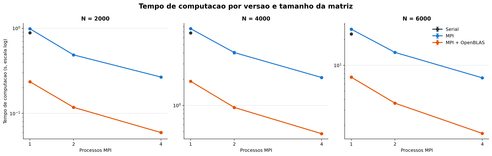
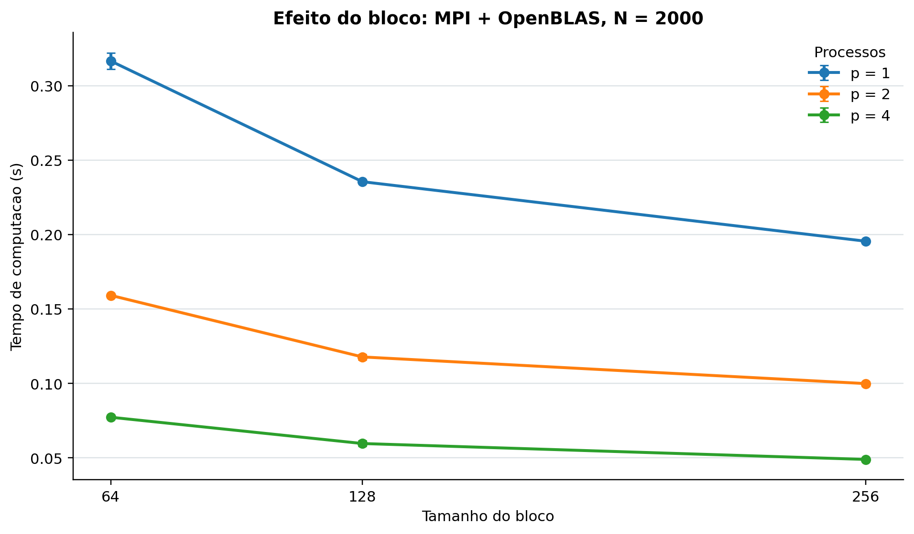
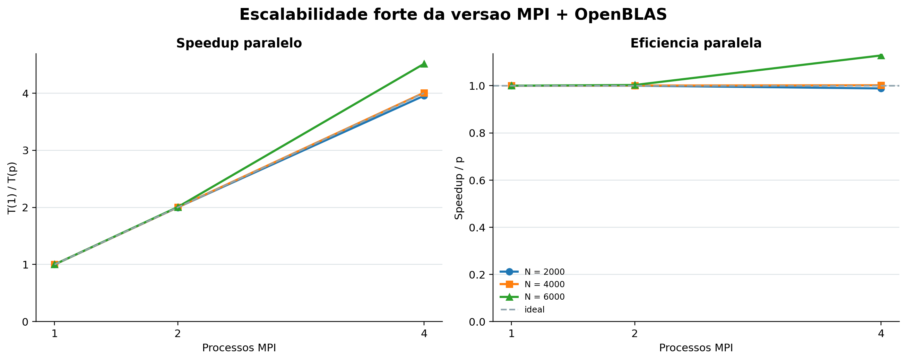
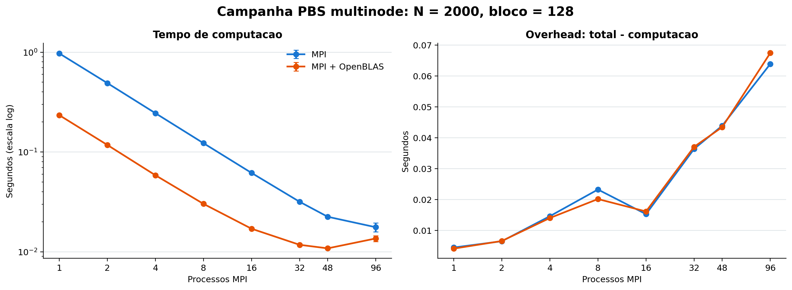
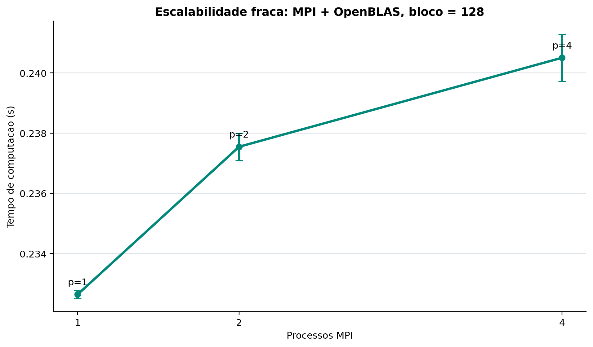

# Multiplicacao de Matrizes em Blocos com MPI e OpenBLAS

## Resumo

Este trabalho compara tres implementacoes de multiplicacao de matrizes
quadradas `float`: uma versao serial em blocos, uma versao distribuida com MPI
sem BLAS e uma versao distribuida com MPI usando `cblas_sgemm` do OpenBLAS.

Os resultados foram coletados no Lovelace/CENAPAD. A validacao independente
terminou com `validation=ok` nas tres versoes. A campanha principal tem 105
medicoes validas, correspondentes a 35 configuracoes com tres repeticoes cada.
Tambem foram coletadas 51 medicoes em dois nos e nove medicoes de escalabilidade
fraca.

O OpenBLAS foi executado com uma thread por processo. Para `N=6000`, bloco 128
e quatro processos, MPI + OpenBLAS apresentou tempo medio de 1.609950 s,
contra 7.135342 s da versao MPI e 23.145013 s da versao serial. A campanha
multinode atingiu o menor tempo de computacao da versao MPI + OpenBLAS em 48
processos, com 0.010830 s; em 96 processos o tempo subiu para 0.013609 s,
indicando saturacao ou aumento do custo de comunicacao para este tamanho de
problema.

Todos os valores deste relatorio foram derivados dos logs preservados em
`results/raw/` e dos CSVs em `results/processed/`. Nenhum valor foi estimado
para preencher uma medicao ausente.

## Ambiente Experimental

| Item | Configuracao observada |
|---|---|
| Cluster | Lovelace, CENAPAD/UNICAMP |
| Host de login | `lovelace.ada.cenapad.unicamp.br` |
| Nos PBS | `adano05` e `adano27` |
| CPU | AMD EPYC 7282 16-Core Processor |
| Memoria observada | 62 GiB no host de login |
| Sistema | Linux kernel `4.18.0-553.150.1.el8_10.x86_64` |
| Compilador | GCC 9.4.0, modulo `gcc/9.4.0` |
| MPI | OpenMPI 4.1.1, modulo `openmpi/4.1.1-gcc-9.4.0` |
| CMake | 4.3.1, modulo `cmake/4.3.1` |
| OpenBLAS | 0.3.21, modulo `openblas/0.3.21-gcc-9.4.0` |
| Launcher | `/opt/pub/openmpi/4.1.1/gcc/9.4.0/bin/mpiexec` |
| Threads OpenBLAS | `OPENBLAS_NUM_THREADS=1` |
| Job multinode | `1032047.ada`, fila `paralela` |
| Alocacao multinode | 2 nos, 128 CPUs e 128 processos MPI por no |

O executavel `mpi_blas_mm` foi verificado com `ldd` e esta ligado a
`libopenblas.so.0`. As evidencias completas estao em
`results/environment/final-inventory/`.

Os benchmarks de um processo a quatro processos da campanha principal foram
executados no host SSH, onde havia uma CPU visivel para a sessao. Portanto,
essa parte mede principalmente oversubscription e nao deve ser interpretada
como uma medida isolada de escalabilidade de nucleos fisicos. A campanha PBS
multinode e usada para observar o comportamento com recursos alocados.

## Implementacao

As tres versoes usam matrizes quadradas em armazenamento contiguo, com valores
`float` gerados deterministicamente a partir de uma semente. O tamanho da
matriz, o bloco e a semente sao configuraveis:

```text
--n N --block B --seed S
```

- **Serial:** multiplicacao tiled sem BLAS.
- **MPI:** distribuicao das linhas de `A`, broadcast de `B`, multiplicacao
  local tiled e coleta de `C`.
- **MPI + OpenBLAS:** mesma distribuicao MPI, usando `cblas_sgemm` para cada
  produto local de blocos.

O tempo de computacao MPI e o maximo do tempo local entre os processos. O tempo
total inclui broadcast, distribuicao, computacao, reducao, sincronizacao e
coleta. A validacao ocorre depois da medicao e possui um cronometro separado.

## Validacao de Corretude

A referencia usada na validacao e uma multiplicacao serial independente com
ordem de loops `i-j-k`, diferente da implementacao tiled usada na computacao.
Assim, a comparacao verifica tanto a distribuicao MPI quanto a implementacao
por blocos e a chamada BLAS.

Comandos executados para `N=128`, bloco 32 e dois processos MPI:

```bash
./build/serial_mm --n 128 --block 32 --validate
mpiexec -np 2 ./build/mpi_mm --n 128 --block 32 --validate
OPENBLAS_NUM_THREADS=1 mpiexec -np 2 ./build/mpi_blas_mm --n 128 --block 32 --validate
```

Foram usadas tolerancias de `1.0e-3` para erro absoluto e `1.0e-4` para erro
relativo. O resultado e aceito quando pelo menos uma das duas tolerancias e
respeitada em cada elemento, criterio adequado para acumulacao em precisao
simples.

| Versao | Erro absoluto maximo | Erro relativo maximo | Validacao (s) | Resultado |
|---|---:|---:|---:|---|
| Serial | 2.86102295e-06 | 0.00520082 | 0.0026518 | `ok` |
| MPI | 2.86102295e-06 | 0.00520082 | 0.0026212 | `ok` |
| MPI + OpenBLAS | 6.67572021e-06 | 0.00440960 | 0.0027135 | `ok` |

O erro relativo maximo pode ser maior que `1.0e-4` em elementos cujo valor de
referencia e pequeno, mas o erro absoluto permanece abaixo de `1.0e-3`. O
tempo de validacao nao entra em `compute_seconds` nem em `total_seconds`.
Os logs estao em `results/raw/correctness/independent-reference.out`.

## Metodologia de Desempenho

A campanha forte usou:

- matrizes `N=2000`, `4000` e `6000`;
- blocos `64`, `128` e `256` para `N=2000`;
- bloco `128` para `N=4000` e `N=6000`, reduzindo o custo da campanha;
- versoes serial, MPI e MPI + OpenBLAS;
- `p=1, 2, 4` na campanha principal;
- tres repeticoes por configuracao;
- execucao sem `--validate`, para nao incluir validacao de matrizes grandes.

Para cada grupo foram calculados media, desvio-padrao populacional, minimo e
maximo. As barras de erro dos graficos representam o desvio-padrao das tres
repeticoes.

### Tempo por Tamanho da Matriz



Para bloco 128, as medias de `compute_seconds` da versao MPI + OpenBLAS foram:

| N | Serial | MPI + OpenBLAS p=1 | MPI + OpenBLAS p=2 | MPI + OpenBLAS p=4 |
|---:|---:|---:|---:|---:|
| 2000 | 0.882474 | 0.235511 | 0.117759 | 0.059574 |
| 4000 | 6.810632 | 1.893012 | 0.945933 | 0.472410 |
| 6000 | 23.145013 | 7.264287 | 3.621751 | 1.609950 |

O crescimento do tempo acompanha aproximadamente o custo cubico esperado da
multiplicacao. O OpenBLAS reduz fortemente o custo constante, enquanto o MPI
reduz o trabalho computacional por processo. A comunicacao passa a ser mais
relevante conforme o tempo de computacao local diminui.

### Influencia do Tamanho do Bloco



As medias da versao MPI + OpenBLAS para `N=2000` foram:

| Bloco | p=1 | p=2 | p=4 |
|---:|---:|---:|---:|
| 64 | 0.316600 | 0.159129 | 0.077233 |
| 128 | 0.235511 | 0.117759 | 0.059574 |
| 256 | 0.195526 | 0.099847 | 0.048887 |

O bloco 256 foi o mais rapido nos tres niveis de processos testados. Blocos
menores aumentam a quantidade de chamadas e loops de tiles; blocos maiores
reduzem essa sobrecarga neste ambiente, embora possam aumentar a pressao sobre
cache em outras arquiteturas ou tamanhos de matriz. Esta conclusao e limitada
ao conjunto `N=2000`, pois os blocos 64 e 256 nao foram medidos para `N=4000`
e `N=6000` na campanha principal.

## Speedup e Eficiencia

Ha duas referencias diferentes e elas nao devem ser misturadas:

1. **Ganho relativo a serial:** `T_serial / T_versao(p)`. Mede o ganho total de
   trocar a implementacao serial pela versao MPI ou MPI + OpenBLAS.
2. **Speedup paralelo:** `T_versao(1) / T_versao(p)`. Mede somente o efeito de
   aumentar o numero de processos dentro da mesma versao.

A eficiencia paralela e `speedup_paralelo / p`. O arquivo
`speedup_efficiency.csv` preserva as duas referencias: as colunas `speedup` e
`efficiency` sao relativas a serial, enquanto `parallel_speedup` e
`parallel_efficiency` sao as metricas convencionais de escalabilidade da
mesma versao.



Para `N=6000`, bloco 128 e MPI + OpenBLAS, o speedup relativo a serial foi
3.186 em p=1, 6.391 em p=2 e 14.376 em p=4. Esse ganho combina BLAS e MPI;
por isso sua eficiencia relativa a serial pode ultrapassar 1 e nao deve ser
chamada de eficiencia paralela. A eficiencia paralela deve ser lida no grafico
acima ou nas colunas `parallel_efficiency`.

## Escalabilidade Forte PBS Multinode

A campanha PBS usou `N=2000`, bloco 128, dois nos e tres repeticoes nos niveis
de processos `1, 2, 4, 8, 16, 32, 48 e 96`. As medias de computacao foram:

| Processos | MPI | MPI + OpenBLAS |
|---:|---:|---:|
| 1 | 0.972636 | 0.234000 |
| 2 | 0.490366 | 0.117708 |
| 4 | 0.244848 | 0.058498 |
| 8 | 0.122588 | 0.030240 |
| 16 | 0.061729 | 0.017037 |
| 32 | 0.031724 | 0.011754 |
| 48 | 0.022448 | 0.010830 |
| 96 | 0.017630 | 0.013609 |



MPI + OpenBLAS atingiu seu menor tempo de computacao em 48 processos. Ao
passar para 96 processos, o tempo aumentou 25.7% em relacao a 48 processos.
Na versao MPI sem BLAS, o tempo ainda caiu em 96 processos, mas com eficiencia
paralela menor, aproximadamente 0.517. O comportamento indica que o tamanho
fixo de `N=2000` deixa pouco trabalho por processo nos niveis mais altos.

O overhead medio de `total_seconds - compute_seconds` na versao MPI + OpenBLAS
foi aproximadamente 0.0041 s em p=1, 0.0221 s em p=8, 0.0437 s em p=48 e
0.0680 s em p=96 na primeira repeticao documentada. Esse overhead inclui
broadcast, distribuicao, sincronizacao e coleta; seu crescimento explica parte
da piora em p=96.

Nao foi feita uma comparacao controlada mantendo todo o restante fixo entre um
no e dois nos: a campanha principal foi executada no host SSH e a campanha
multinode pelo PBS. Portanto, o resultado demonstra o comportamento observado
com a alocacao multinode, mas nao deve ser apresentado como um speedup puro de
numero de nos.

## Escalabilidade Fraca

Foi usada a regra aproximada `N proporcional a p^(1/3)`, mantendo o trabalho
computacional por processo aproximadamente constante:

| Processos | N | Bloco | Versao | Media (s) | Desvio-padrao (s) |
|---:|---:|---:|---|---:|---:|
| 1 | 2000 | 128 | MPI + OpenBLAS | 0.232640 | 0.000139 |
| 2 | 2520 | 128 | MPI + OpenBLAS | 0.237548 | 0.000454 |
| 4 | 3175 | 128 | MPI + OpenBLAS | 0.240504 | 0.000778 |



O tempo aumentou apenas 3.4% entre p=1 e p=4 nas configuracoes testadas,
indicando comportamento aproximadamente constante. Esta campanha foi feita em
um unico host com as limitacoes de CPU visivel registradas no inventario, logo
nao deve ser interpretada como uma prova de escalabilidade fraca em varios nos.

## Memoria e Gargalos

Considerando tres matrizes `float` completas, o armazenamento teorico e:

| N | Tres matrizes |
|---:|---:|
| 2000 | 0.0447 GiB |
| 4000 | 0.1788 GiB |
| 6000 | 0.4023 GiB |

Esses valores nao incluem buffers MPI, bibliotecas ou temporarios. Sao
estimativas de armazenamento, nao medidas de RSS. A implementacao MPI replica
`B` nos processos e distribui linhas de `A`, enquanto o processo raiz mantem o
resultado coletado. Essa escolha simplifica a distribuicao, mas aumenta a
pressao agregada de memoria conforme o numero de processos cresce.

Os principais gargalos observados sao:

- custo de broadcast e coleta, visivel na diferenca entre tempo total e tempo
  de computacao;
- sincronizacao e latencia quando o trabalho por processo fica pequeno;
- chamadas e loops adicionais para blocos menores;
- saturacao ou desequilibrio em MPI + OpenBLAS acima de 48 processos para
  `N=2000`;
- possivel pressao de cache para blocos muito grandes, embora 256 tenha sido o
  melhor dos blocos medidos neste ambiente.

## Reprodutibilidade

Os logs brutos, inventarios, CSVs e graficos estao versionados. O fluxo de
processamento e:

```bash
python3 scripts/process_results.py --raw-dir results/raw/benchmark-final
python3 scripts/process_results.py --raw-dir results/raw/1032047.ada-20261019-163130-multinode --prefix multinode
python3 scripts/process_results.py --raw-dir results/raw/weak-20261019-145859 --prefix weak
python3 scripts/plot_results.py
python3 scripts/generate_report_pdf.py
```

O processamento produz medições individuais, estatisticas, speedup relativo
à serial e speedup/eficiencia paralelos. Os scripts PBS passaram por `bash -n`.
As medições da campanha multinode foram executadas com o commit
`d42be2b22ad525f6064530d1c56e32dda3f42c43`, registrado no inventario final;
as alterações posteriores de validacao, processamento e documentacao nao
alteram os tempos coletados.
Os artefatos principais sao:

- `results/environment/final-inventory/`;
- `results/raw/correctness/`;
- `results/raw/benchmark-final/`;
- `results/raw/1032047.ada-20261019-163130-multinode/`;
- `results/raw/weak-20261019-145859/`;
- `results/processed/`;
- `results/plots/`;
- `report/report.pdf`.

## Mapa de Evidencias e Arquivos

Todos os itens abaixo apontam para o repositorio e podem ser abertos
diretamente no GitHub.

### Especificacao e Codigo

- [Instrucoes da atividade](../instrucoe.txt)
- [README e escopo do projeto](../README.md)
- [CMakeLists.txt](../CMakeLists.txt)
- [Implementacao serial](../src/serial_mm.cpp)
- [Implementacao MPI](../src/mpi_mm.cpp)
- [Implementacao MPI + OpenBLAS](../src/mpi_blas_mm.cpp)
- [Nucleo da multiplicacao MPI/BLAS](../src/mpi_matmul.cpp)
- [Funcoes comuns e referencia independente](../src/matmul_common.cpp)
- [Cabecalhos publicos](../include/matmul_common.hpp)

### Execucao e Reproducibilidade

- [Guia de execucao](../docs/execution-guide.md)
- [Plano experimental](../docs/experimental-plan.md)
- [Checklist de execucao](../docs/execution-checklist.md)
- [PBS de compilacao](../pbs/build.pbs)
- [PBS da campanha principal](../pbs/run_experiments.pbs)
- [PBS da campanha multinode](../pbs/run_multinode.pbs)
- [Coleta do ambiente](../scripts/collect_environment.sh)
- [Processamento dos logs](../scripts/process_results.py)
- [Geracao dos graficos](../scripts/plot_results.py)
- [Geracao deste PDF](../scripts/generate_report_pdf.py)
- [Dependencias Python](../scripts/requirements.txt)

### Validacao e Logs Brutos

- [Log da validacao independente](../results/raw/correctness/independent-reference.out)
- [Todos os logs da campanha principal](../results/raw/benchmark-final/)
- [Campanha principal N=2000](../results/raw/benchmark-final/final-20261019-144917/)
- [Campanha principal N=4000 e N=6000](../results/raw/benchmark-final/final-20261019-145103/)
- [Logs da escalabilidade fraca](../results/raw/weak-20261019-145859/)
- [Logs da campanha PBS multinode](../results/raw/1032047.ada-20261019-163130-multinode/)
- [Ambiente da campanha multinode](../results/raw/1032047.ada-20261019-163130-multinode/environment.txt)
- [Nodefile preservado](../results/raw/1032047.ada-20261019-163130-multinode/nodefile)

### Inventario do Cluster e Compilacao

- [Inventario final completo](../results/environment/final-inventory/)
- [Sistema, CPU e memoria](../results/environment/final-inventory/system.txt)
- [Comandos, fila, nos e modulos](../results/environment/final-inventory/commands.txt)
- [PBS e nos alocados](../results/environment/final-inventory/pbs-and-nodes.txt)
- [Bibliotecas BLAS](../results/environment/final-inventory/blas-libraries.txt)
- [Resumo dos calculos derivados](../results/environment/final-inventory/analysis-summary.txt)
- [Pipeline de processamento](../results/environment/process-pipeline.txt)
- [Log de compilacao final](../results/environment/build-final.txt)
- [Verificacao final do OpenBLAS](../results/environment/mpi_blas_ldd-final.txt)
- [Recompilacao e validacao independente](../results/environment/rebuild-independent-validation.txt)
- [Tentativas e estados dos jobs multinode](../results/environment/multinode-attempts.txt)

### CSVs Processados

- [Medicoes da campanha principal](../results/processed/measurements.csv)
- [Estatisticas da campanha principal](../results/processed/statistics.csv)
- [Speedup e eficiencia da campanha principal](../results/processed/speedup_efficiency.csv)
- [Medicoes multinode](../results/processed/multinode_measurements.csv)
- [Estatisticas multinode](../results/processed/multinode_statistics.csv)
- [Speedup e eficiencia multinode](../results/processed/multinode_speedup_efficiency.csv)
- [Medicoes de escalabilidade fraca](../results/processed/weak_measurements.csv)
- [Estatisticas de escalabilidade fraca](../results/processed/weak_statistics.csv)
- [Speedup de escalabilidade fraca](../results/processed/weak_speedup_efficiency.csv)

### Graficos e Entrega

- [Tempo por tamanho da matriz](../results/plots/report_01_tempo_por_tamanho.png)
- [Efeito do tamanho do bloco](../results/plots/report_02_efeito_bloco.png)
- [Escalabilidade forte](../results/plots/report_03_escalabilidade_forte.png)
- [Campanha multinode](../results/plots/report_04_multinode.png)
- [Escalabilidade fraca](../results/plots/report_05_escalabilidade_fraca.png)
- [Todos os graficos versionados](../results/plots/)
- [Relatorio final em PDF](./report.pdf)

## Conclusao

MPI + OpenBLAS foi a alternativa mais rapida em todas as configuracoes
comparaveis. O OpenBLAS reduz substancialmente o custo da multiplicacao local,
enquanto MPI distribui o trabalho entre processos. A escalabilidade e boa nos
primeiros niveis de processos, mas o ganho deixa de crescer proporcionalmente
quando o trabalho por processo se torna pequeno e os custos de comunicacao e
saturacao dominam.

Os resultados sustentam as conclusoes para o hardware, tamanhos, blocos,
numero de processos e configuracoes executados. Nao sustentam generalizacoes
para outras arquiteturas, mais threads OpenBLAS, outros tamanhos de bloco ou
uma comparacao pura de um no contra dois nos sem nova campanha controlada.
